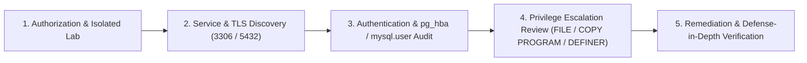

# Database Security Audit

> [!CAUTION]
> **Authorized Security Testing Only:** Use all reconnaissance, privilege-audit, and configuration-review commands in this repository strictly on systems you own, explicitly authorized audit engagements, or isolated ephemeral lab containers.

Structured field notes and operational procedures for auditing MySQL/MariaDB and PostgreSQL security posture, privilege boundaries, authentication configuration, and hardening controls.

## Security Audit Workflow

## Documentation Portal (Diátaxis)

Structured hands-on labs, strict operational runbooks, factual catalogs, and architecture explanations live in [`docs/index.md`](docs/index.md):

- **Tutorials:** [Isolated Ephemeral Docker MySQL & PostgreSQL Audit Lab](docs/01-tutorials/index.md)
- **How-To Guides:** [Non-Destructive Audit Runbooks in ASD-STE100 Issue 9](docs/02-how-to-guides/index.md)
- **Reference:** [Ports, Catalog Views, Dangerous Privileges & Hardening Matrix](docs/03-reference/index.md)
- **Explanation:** [Privilege Boundaries, Attack Surfaces & Defense-in-Depth](docs/04-explanation/index.md)

## Field Reference Guides

| Guide | Scope | File |
| :--- | :--- | :--- |
| **MySQL / MariaDB** | Enumeration, `mysql.user` / `authentication_string`, `FILE` / `PROCESS` / `SUPER` / `DEFINER` / `PROXY` privileges, CIS Nmap audit | [`MySQL database penetration testing.md`](MySQL%20database%20penetration%20testing.md) |
| **PostgreSQL** | Roles & `default_roles`, `pg_hba.conf`, `SCRAM-SHA-256`, `COPY ... PROGRAM`, `pg_read_server_files`, `dblink`, `pg_shadow` | [`PostgreSQL database penetration testing.md`](PostgreSQL%20database%20penetration%20testing.md) |
