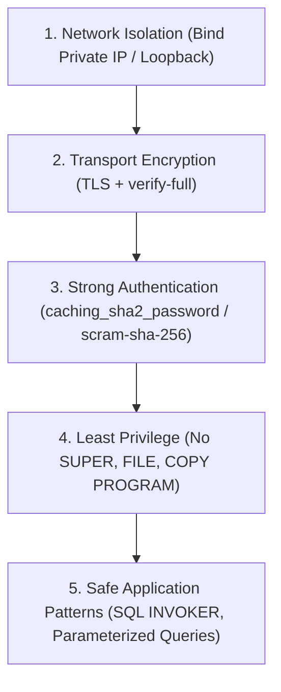

# Privilege Boundaries, Attack Surfaces, and Defense-in-Depth

Database security failures rarely occur from a single missing patch. Most compromises combine network exposure, weak authentication, excessive database privileges, and OS filesystem access.

## Defense-in-Depth Layers

## Key Privilege Escalation Boundaries

### 1. Database Privileges That Cross Into the Operating System

- **MySQL `FILE` (`LOAD_FILE`, `INTO DUMPFILE`)**: When `secure_file_priv` is empty or points to web/plugin directories, a database account with `FILE` crosses from SQL scope into the OS filesystem as the `mysql` service user. Setting `secure_file_priv = NULL` closes file read/write abuse entirely when data imports are not needed.
- **PostgreSQL `pg_execute_server_program` & `SUPERUSER`**: By design, superusers and `pg_execute_server_program` members can invoke OS commands through `COPY ... FROM PROGRAM`. Separating application roles from schema owners (`NOSUPERUSER NOCREATEDB NOCREATEROLE`) ensures SQL injection cannot jump to OS execution.

### 2. Stored Routine Execution Context (`DEFINER` vs `INVOKER`)

- In MySQL, stored routines default to `SQL SECURITY DEFINER`. An account holding only `EXECUTE` runs the procedure body under the creator's privileges (often `root@localhost`).
- If the procedure constructs SQL strings dynamically via `CONCAT` + `PREPARE`, an unprivileged caller escalates privileges to the `DEFINER` account. Using parameterized static SQL and `SQL SECURITY INVOKER` eliminates routine privilege escalation.

### 3. Secondary Credential Leakage (`pg_hba.conf`, `dblink`, Views)

- Plaintext passwords embedded inside `dblink(...)` view definitions remain readable via `pg_get_viewdef()` to users granted catalog read access.
- Replacing `trust`/`md5` entries in `pg_hba.conf` with `scram-sha-256` and external secret management prevents credential replay across servers.
