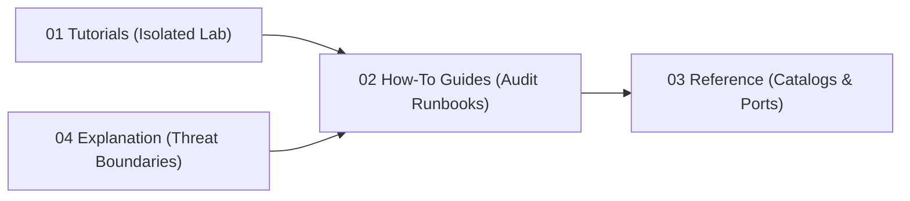

# Database Security Audit Documentation

> [!CAUTION]
> **Authorized Lab & Assessment Use Only:** Run audit commands strictly against isolated local containers or explicitly authorized target databases.

Documentation for `Database-Security-Audit`, organized with the Diátaxis framework across MySQL/MariaDB and PostgreSQL security assessments.

## Quadrants

| Quadrant | Focus | Entry Point |
| :--- | :--- | :--- |
| **Tutorials** | Safe ephemeral Docker security audit lab | [Tutorials Index](01-tutorials/index.md) |
| **How-To Guides** | Non-destructive MySQL & PostgreSQL audit runbooks | [How-To Guides Index](02-how-to-guides/index.md) |
| **Reference** | Ports, catalogs, privileges & Nmap checks | [Reference Index](03-reference/index.md) |
| **Explanation** | Privilege escalation paths & defense-in-depth | [Explanation Index](04-explanation/index.md) |

[Back to Repository Overview](../README.md)
